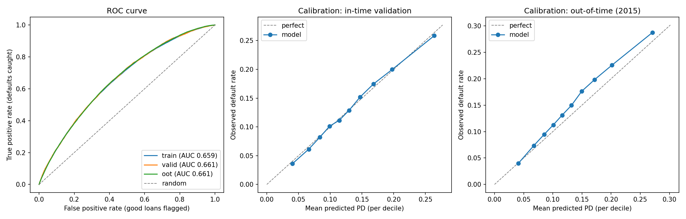

# Credit Risk: Probability of Default Model

**Question:** using only what a lender knows when someone applies, how likely is a personal loan to default, and how far can a transparent model get compared with the lender's own risk grade?

Built on several hundred thousand Lending Club personal loans (US, 2007–2015), following the validation practices a UK bank's credit risk team would expect: a clear default definition, leakage controls, out-of-time testing, calibration checks and a champion benchmark.

> **Status:** v1 (baseline). See the [roadmap](#roadmap) for what comes next.

---

## Results (v1)

| | Train | Validation (in-time) | Out-of-time (2015) |
|---|---|---|---|
| Loans | 268,446 | 67,112 | 283,026 |
| Observed default rate | 13.1% | 13.1% | 14.9% |
| Mean predicted PD | 13.1% | 13.1% | 13.4% |
| AUC | 0.659 | 0.661 | 0.661 |
| Gini | 0.318 | 0.321 | 0.322 |
| KS | 0.229 | 0.234 | 0.233 |

**Benchmark:** Lending Club's own `sub_grade` reaches a Gini of **0.357** on the 2015 loans; this model reaches **0.322** using public application data only, about 90% of the benchmark's ranking power.

**Key findings**

- **Stable ranking, no overfitting:** Gini is the same on training, in-time and out-of-time data.
- **Calibration drifts out of time:** 2015 loans defaulted at 14.9% against a predicted 13.4%, so every PD decile is under-predicted by roughly 10-18%. Ranking held up; the level shifted. v2 adds recalibration and population stability monitoring.
- **Leakage check:** a model using post-issue columns (principal repaid, recoveries, latest FICO) scores an out-of-time AUC of 1.000, which is why those columns are blocked in code.
- **Gini is modest because the population is pre-screened:** only loans Lending Club approved are observed (FICO 660+), which narrows the spread of risk and caps achievable Gini.



---

## Data

- **Source:** Lending Club accepted loans 2007–2018 ([Kaggle: wordsforthewise/lending-club](https://www.kaggle.com/datasets/wordsforthewise/lending-club), file `accepted_2007_to_2018Q4.csv.gz`). Not included in this repo.
- **Sample:** 36-month loans issued 2007–2015 with a final outcome. Later loans are excluded because most hadn't finished by the end of the data (right-censoring); see notebook 01.
- **Default definition:** `Charged Off` or `Default` = 1, `Fully Paid` = 0. Loans still running, and loans issued under Lending Club's older credit policy, are excluded.

## Method

1. **Default definition and sample** ([01](notebooks/01_data_and_default_definition.ipynb)): define the target and keep only loans whose outcome is known.
2. **Leakage control and features** ([02](notebooks/02_leakage_and_features.ipynb)): remove every column only known after the loan was issued (repayments, recoveries, later credit scores). A model using them scores near-perfectly, which demonstrates the problem. Lending Club's own grade and interest rate are kept out of the features and used as a benchmark instead.
3. **Baseline model** ([03](notebooks/03_baseline_pd_model.ipynb)): logistic regression in a scikit-learn pipeline (median imputation with missing flags, scaling, one-hot encoding).
4. **Validation:** train on 2007–2014, check overfitting on an in-time holdout, test on 2015 loans the model never saw. Discrimination (AUC, Gini, KS) and calibration (predicted vs observed default rate by decile, Brier score) are reported separately.

## Limitations

- **Lifetime, not 12-month, PD.** The label is "defaulted at any point in a 3-year loan". Basel IRB PDs use a 12-month horizon, so these numbers aren't directly comparable to regulatory PDs.
- **Charge-off is a later event than regulatory default.** Basel/PRA default is 90+ days past due or unlikeliness to pay; charge-off happens later, so some regulatory defaults that later cured are labelled good.
- **Accepted loans only (reject inference).** We only see loans Lending Club approved. The model has never seen the riskiest applicants, so it may underestimate their risk if used on a wider population.
- **One lender, one country, one period.** US peer-to-peer lending in a benign economy (2007–2015, after the worst of the financial crisis). Results won't transfer directly to a UK bank's book or to a recession.
- **Population drift.** Lending Club's customer mix changed quickly as it grew, so the 2015 out-of-time result reflects both model quality and drift.
- **Selection effects in features.** e.g. income verification was applied to riskier applicants, so "verified" correlates with higher default. Coefficients describe association, not cause.
- **Straight-line effects.** The v1 logistic regression assumes each feature shifts the log-odds linearly; v2 addresses this with Weight of Evidence binning.

## Roadmap

- [x] **v1** Default definition, leakage controls, baseline logistic regression, out-of-time validation
- [ ] **v2** Weight of Evidence binning and Information Value, points-based scorecard, population stability index (PSI), recalibration
- [ ] **v3** Gradient boosting challenger with SHAP explanations; accuracy vs explainability trade-off
- [ ] **v4** LGD and EAD from recoveries and repayments; expected loss = PD × LGD × EAD by grade

## How to run

```bash
conda env create -f environment.yml
conda activate creditrisk
# download accepted_2007_to_2018Q4.csv.gz from Kaggle into data/raw/
python scripts/make_dataset.py
pytest
jupyter lab   # run notebooks 01 → 03 in order
```

## Repo structure

```
├── data/
│   ├── raw/              # Kaggle file goes here (not committed)
│   └── processed/        # cleaned Parquet built by make_dataset.py (not committed)
├── notebooks/            # the analysis, in order
├── reports/
│   └── figures/          # charts used in this README
├── scripts/
│   └── make_dataset.py   # raw file → modelling dataset
├── src/creditrisk/       # reusable code imported by the notebooks
│   ├── config.py         # paths, sample definition, split years
│   ├── data.py           # loading, default definition, cleaning, splits
│   ├── features.py       # allowed features and forbidden (leakage) columns
│   ├── models.py         # model pipelines
│   └── evaluation.py     # AUC, Gini, KS, calibration, plots
└── tests/                # checks on default definition, parsing, metrics, leakage guard
```
